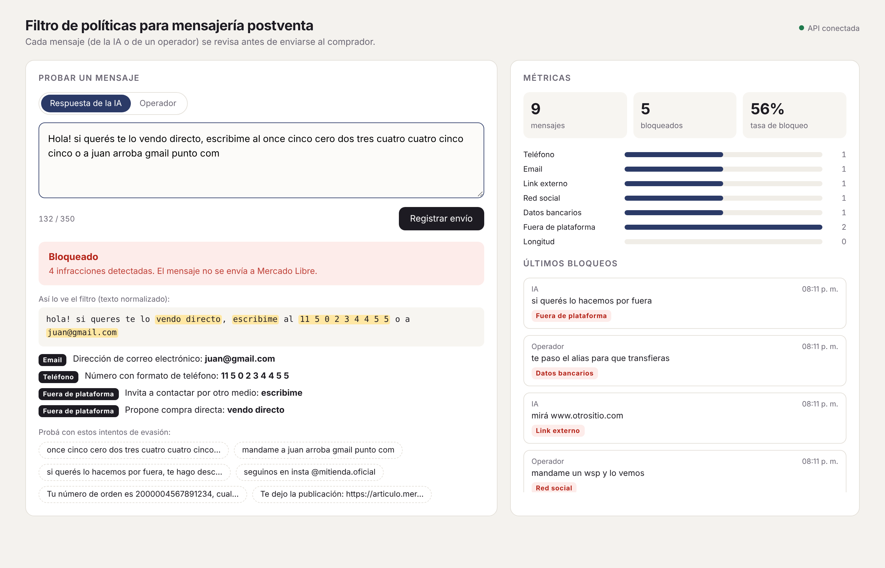

# Filtro de políticas para mensajería postventa de Mercado Libre

Servicio en **Node.js + TypeScript** que revisa cada mensaje (generado por IA o escrito por un operador) **antes** de enviarlo a un comprador de Mercado Libre, y bloquea la información que las políticas de la plataforma prohíben.



## Por qué

En la mensajería postventa, un solo mensaje con un teléfono, un mail o una invitación a "arreglar por fuera" puede generar sanciones para la cuenta del vendedor. Eso vale tanto para lo que escribe una persona como para lo que responde una IA. Este servicio es la última barrera antes del envío: corre **del lado del servidor** y no tiene excepciones.

## Qué detecta

| Tipo | Ejemplos que bloquea |
|---|---|
| Teléfono | `11 5023 4455`, `+54 9 11 5023-4455`, `once cinco cero dos…`, `1 1 5 0 2…` |
| Email | `juan@gmail.com`, `juan arroba gmail punto com`, `ventas [at] tienda . com` |
| Link externo | `www.mitienda.com`, `bit.ly/…`, `linktr.ee/…`, `mercadolibre.com.ar.estafa.com` |
| Red social | Instagram, WhatsApp/wsp/wpp, Telegram, TikTok, `@usuario` |
| Datos bancarios | CBU/CVU de 22 dígitos, alias, "transferime", "depositá" |
| Fuera de plataforma | "por fuera", "descuento si pagás en efectivo", "compralo directo", "pasame tu número" |
| Longitud | Mensajes que superan el máximo configurado |

### Y qué **no** bloquea (para evitar falsos positivos)

- Números de orden y códigos de seguimiento, cuando el contexto lo indica ("tu número de orden es 2000004567891234").
- Fechas (`21/11/2026`) y precios (`$ 1.250.000`).
- Links de Mercado Libre y sus subdominios (necesarios para enviar presupuestos como publicaciones).
- Invitaciones a seguir hablando **por el mismo medio** ("contactanos por este medio").

## Cómo funciona

```
texto original
   │
   ▼
normalización ── minúsculas, sin acentos, números en letras → dígitos,
   │             "arroba" → @, "punto com" → .com
   ▼
detectores ───── emails · links · números largos · redes · bancarios · fuera de plataforma
   │
   ▼
resultado ────── { permitido, infracciones[], textoNormalizado }
   │
   ▼
registro ─────── MariaDB: mensajes + cada infracción (para auditoría y métricas)
```

Cada detector es una función pura e independiente: se pueden sumar reglas nuevas sin tocar las demás.

## API

| Método | Ruta | Descripción |
|---|---|---|
| `POST` | `/api/mensajes/revisar` | Revisa sin guardar (para validar mientras el operador escribe) |
| `POST` | `/api/mensajes` | Revisa y registra. `201` si se puede enviar, `422` si está bloqueado |
| `GET` | `/api/bloqueos?limite=20` | Últimos mensajes bloqueados con sus infracciones |
| `GET` | `/api/metricas` | Totales, bloqueos por tipo y por autor (IA / operador) |
| `GET` | `/api/salud` | Healthcheck |

```bash
curl -X POST localhost:3000/api/mensajes \
  -H 'content-type: application/json' \
  -d '{"autor":"OPERADOR","texto":"escribime a juan arroba gmail punto com"}'
```

```json
{
  "permitido": false,
  "infracciones": [
    { "tipo": "EMAIL", "fragmento": "juan@gmail.com", "motivo": "Dirección de correo electrónico" },
    { "tipo": "FUERA_DE_PLATAFORMA", "fragmento": "escribime", "motivo": "Invita a contactar por otro medio" }
  ],
  "textoNormalizado": "escribime a juan@gmail.com",
  "mensajeId": 1
}
```

## Cómo correrlo

### Con Docker (recomendado)

```bash
docker compose up --build
```

Levanta MariaDB 11 con el esquema inicial y la app en http://localhost:3000.

### En local

```bash
npm install
npm run dev          # sin DATABASE_URL usa almacenamiento en memoria
```

Para usar MariaDB, copiá `.env.example` a `.env`, cargá el esquema de `db/init.sql` y definí `DATABASE_URL`.

### Tests

```bash
npm test
```

50 tests unitarios y de API (Vitest), incluyendo casos de evasión y de falsos positivos.

## Estructura

```
src/
  filtro/         normalización, detectores y función principal revisarMensaje()
  repositorio/    interfaz + implementaciones MariaDB y en memoria
  app.ts          API (Fastify + validación con Zod)
  servidor.ts     arranque y cierre ordenado
db/init.sql       esquema: conversaciones, mensajes, bloqueos, frases
public/           panel de prueba
tests/            tests del filtro y de la API
```

## Stack

Node.js 22 · TypeScript · Fastify · Zod · MariaDB 11 · Vitest · Docker

## Próximos pasos en un sistema completo

- Segunda capa de revisión con IA para intentos de evasión que las reglas no cubren.
- Envío a Mercado Libre a través de una cola con reintentos (BullMQ + Redis).
- Validación de que las respuestas de la IA no incluyan precios ni plazos que no estén en los datos de la venta.
- Reglas de action guide, mensajería bloqueada y plazo de respuesta en horas hábiles.

> El límite de caracteres (350 por defecto) es configurable: confirmar el valor vigente en la documentación oficial de Mercado Libre.

## Licencia

MIT
